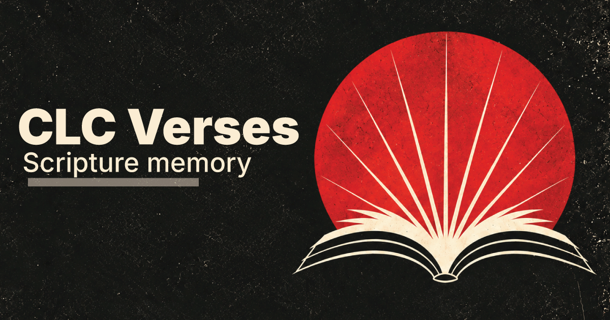

# Re-Verse

Re-Verse is a scripture memory app for [Progress & Perfection](https://progressandperfection.com). Browse a year of weekly verses as flashcards, or spin the Verse Wheel to drill a random one.

**Live site:** https://re-verse-web.netlify.app/

## Who it's for

Anyone memorizing Bible verses — individually or as part of a group study.

## How to use it

1. Open the [library](https://re-verse-web.netlify.app/) and browse verses by theme.
2. Pick a theme to flip through its verse flashcards, or choose **All Verses**.
3. Say the verse from memory, then check yourself against the card.

## Verse Wheel

Prefer to be surprised? Open the [Verse Wheel](https://re-verse-web.netlify.app/verse-wheel/) from the link in the library header, or press **Spin** to land on a random verse. The pick appears full screen until dismissed, with a **Show hint** button (first five words) and a **Show verse** button (full ESV text). Choose a spin time (1, 3, or 6 seconds) and **True Random** or **No Repeats** (no verse comes up twice until all have been seen). A session tracker shows which verses were picked and how many times. Use the **Sections** controls to add or remove whole sections from the wheel, and the **×** on any tracker entry to drop a single verse (restore it from the **Removed verses** list). Session data lives in `sessionStorage`, so it survives a trip Home but resets when the tab closes. The wheel reads `verses.js`, so new weekly verses appear on it automatically.

## Look and feel

The site defaults to a light theme; the sun/moon button in the header switches to dark and remembers the choice (`localStorage`). All colors live in two token blocks at the top of `styles.css` (light, then `html[data-theme="dark"]`). Edit those to recolor the whole site, including the wheel canvas. The seven section colors are `--sec-1` to `--sec-7`.
